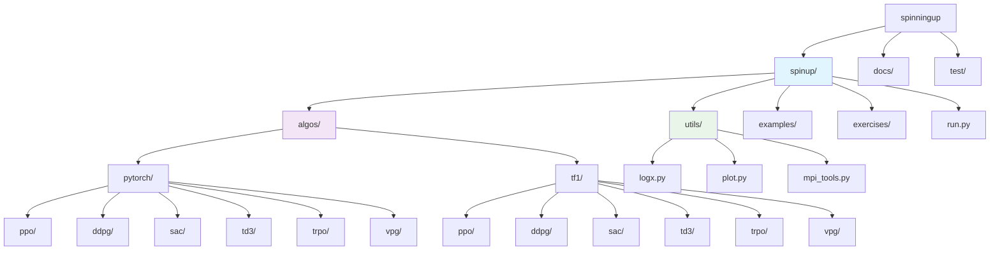

**Status:** Maintenance (expect bug fixes and minor updates)

Welcome to Spinning Up in Deep RL! 
==================================

This is an educational resource produced by OpenAI that makes it easier to learn about deep reinforcement learning (deep RL).

For the unfamiliar: [reinforcement learning](https://en.wikipedia.org/wiki/Reinforcement_learning) (RL) is a machine learning approach for teaching agents how to solve tasks by trial and error. Deep RL refers to the combination of RL with [deep learning](http://ufldl.stanford.edu/tutorial/).

## Quick Installation

```bash
git clone https://github.com/openai/spinningup.git
cd spinningup
pip install -e .
```

**Prerequisites:**
- Python 3.6 or higher
- OpenMPI (for parallel training)
- Platform: Linux or macOS (Windows not officially supported)

For detailed installation instructions including MuJoCo setup, see the [Installation Guide](https://spinningup.openai.com/en/latest/user/installation.html).

## Quick Start

Run your first experiment with PPO on LunarLander:

```bash
python -m spinup.run ppo --env LunarLander-v2 --exp_name quicktest
```

Watch the trained agent:

```bash
python -m spinup.run test_policy data/quicktest/quicktest_s0
```

Plot training results:

```bash
python -m spinup.run plot data/quicktest/quicktest_s0
```

## Implemented Algorithms

Spinning Up includes clean, well-documented implementations of six core deep RL algorithms, available in both **TensorFlow 1** and **PyTorch** versions:

| Algorithm | Full Name | Type | TF1 | PyTorch |
|-----------|-----------|------|-----|---------|
| **VPG** | Vanilla Policy Gradient | On-Policy | ✓ | ✓ |
| **TRPO** | Trust Region Policy Optimization | On-Policy | ✓ | ✓ |
| **PPO** | Proximal Policy Optimization | On-Policy | ✓ | ✓ |
| **DDPG** | Deep Deterministic Policy Gradient | Off-Policy | ✓ | ✓ |
| **TD3** | Twin Delayed Deep Deterministic Policy Gradient | Off-Policy | ✓ | ✓ |
| **SAC** | Soft Actor-Critic | Off-Policy | ✓ | ✓ |

All implementations include:
- [Core algorithm logic](spinup/algos/)
- [Logging and plotting utilities](spinup/utils/)
- [Practical examples](spinup/examples/)
- [Educational exercises](spinup/exercises/)

## Repository Structure



## What's Included

This module contains a variety of helpful resources, including:

- a short [introduction](https://spinningup.openai.com/en/latest/spinningup/rl_intro.html) to RL terminology, kinds of algorithms, and basic theory,
- an [essay](https://spinningup.openai.com/en/latest/spinningup/spinningup.html) about how to grow into an RL research role,
- a [curated list](https://spinningup.openai.com/en/latest/spinningup/keypapers.html) of important papers organized by topic,
- a well-documented [code repo](https://github.com/openai/spinningup) of short, standalone implementations of key algorithms,
- and a few [exercises](https://spinningup.openai.com/en/latest/spinningup/exercises.html) to serve as warm-ups.

Get started at [spinningup.openai.com](https://spinningup.openai.com)!


Citing Spinning Up
------------------

If you reference or use Spinning Up in your research, please cite:

```
@article{SpinningUp2018,
    author = {Achiam, Joshua},
    title = {{Spinning Up in Deep Reinforcement Learning}},
    year = {2018}
}
```